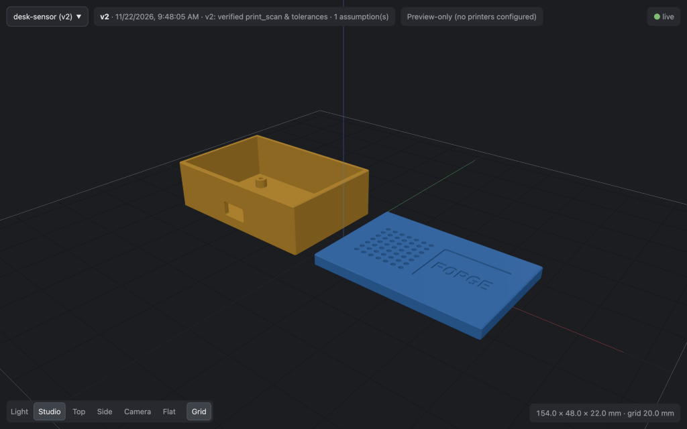
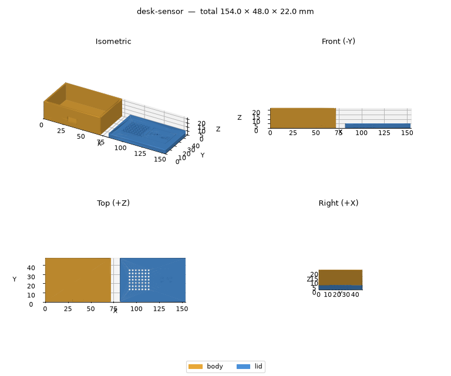
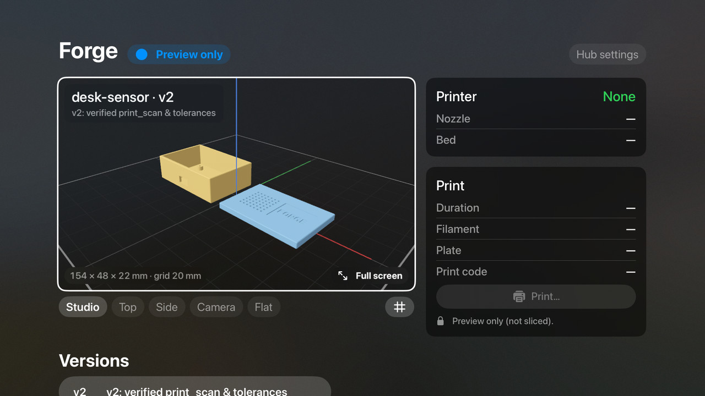

<p align="center">
  
</p>

<h1 align="center">Forge</h1>

<p align="center">
  <strong>Low-token parametric 3D CAD, automated FDM printability checks, offline 3D web/Apple TV preview, and guarded multi-printer dispatch — built for AI coding agents.</strong>
</p>

Describe a physical part to Claude Code, Antigravity, Gemini CLI, Codex, Cursor, or ChatGPT. Forge enforces sourced dimensions, separates parameters (`params.py`) from Build123d geometry, scans layers for printability issues before slicing, previews live in your browser or on Apple TV, and only prints when **you** explicitly approve.

---

## Workflow at a Glance

> **You:** *"Design a 72 × 48 mm desk sensor enclosure with a USB-C port, 4 PCB standoffs, and a vented lid in the `instrument` style."*  
> **Agent:** clarifies measurements → writes `params.py` + Build123d geometry → validates (`forge run`, `print_scan`) → pushes live preview (`forge push --preview`).



| 1. Automated CAD & Printability Check (`forge run`) | 2. Optional Apple TV Viewer (`Forge`, tvOS RealityKit) |
| :---: | :---: |
|  |  |
| Compact 768×640 2×2 render + `report.json` + layer `print_scan` | Inspect `model.usdz` with Siri Remote & approve LAN prints |

---

## Install with an AI Agent (Recommended)

Paste this prompt into **Claude Code**, **Antigravity**, **Gemini CLI**, **Codex**, or **Cursor**:

```text
Clone https://github.com/mskasal/forge, read SETUP.md, ask me which optional
modules I want before configuring anything, then install and verify with `forge doctor`.
```

The agent will ask a few short questions (which AI tool, printer/slicer, local vs. Pi/Docker Hub, optional remote preview, optional Apple TV), install only what you need, and verify the setup.

Prefer manual installation? See [SETUP.md](SETUP.md) or the 60-second quickstart below.

---

## What Forge Is — and What It Is Not

**Forge is:**
- A **parametric CAD workflow** built on [Build123d](https://github.com/gumyr/build123d), designed so AI agents iterate cleanly with minimal token usage (`params.py` + `--fast --json` + compact 768×640 renders + `print_scan`).
- A **dimension & safety discipline**: refuses guessed real-object dimensions (`forge.dim.Dim`) and blocks autonomous printing behind explicit owner approval or single-use print codes.
- **Modular by design**: works on a single laptop with zero extra hardware, and scales to an always-on Raspberry Pi / Docker Hub (~40 MB RAM), multiple printers, read-only remote viewing, and Apple TV.

**Forge is NOT:**
- **Not a visual GUI CAD editor** (not a Fusion 360 / Blender replacement — geometry is code).
- **Not a universal printer driver suite (yet):** v1 slicer CLI and LAN printer control support **Bambu Lab** (LAN mode). Every other 3D printer is fully supported for CAD, printability scanning, STEP/STL export, and 3D preview — slice the exported `.stl`/`.step` in PrusaSlicer, OrcaSlicer, or Cura.
- **Not an autonomous print bot:** agents can never start a print on their own, change printer temperatures, jog axes, or send raw G-code (`hub/printers/bambu_lan.py` `guard()`).
- **Not a remote print server:** optional remote access (`--profile remote`) is **strictly read-only** (3D preview + live print status). Uploading and printing remain LAN-only.
- **Not cloud-dependent:** works 100% offline on localhost/LAN (Three.js is bundled locally). No account or subscription required.

---

## Modules (Core vs. Optional)

| Module | Required? | Where it runs | What it adds | Guide |
| --- | --- | --- | --- | --- |
| **Workstation Core** | **Yes** | Your laptop (Mac / Linux / WSL2) | `forge` CLI, Build123d helpers, `print_scan`, local offline 3D web preview (`forge serve`), multi-agent skills | [SETUP.md](SETUP.md) |
| **Local Slicer** | Optional | Your laptop | Local `.gcode.3mf` slicing + temperature bounds check (v1: Bambu Studio CLI) | [SETUP.md](SETUP.md#2-printer--slicer-optional) |
| **Always-on Hub** | Optional | Raspberry Pi / Docker (~40 MB RAM) | 24/7 versioned model store, live SSE web preview, LAN sharing | [hub/README.md](hub/README.md) |
| **Printer Bridge** | Optional | Hub (0..N printers) | Live status (`GET /printers`) & guarded print dispatch (v1: Bambu LAN) | [hub/README.md](hub/README.md#adding-printers-optional) |
| **Remote Read-Only** | Optional | Hub (`--profile remote`) or Tailscale | Monitor live prints & inspect 3D models from outside home (GET-only) | [deploy/remote/README.md](deploy/remote/README.md) |
| **Apple TV App (`Forge`)** | Optional | Apple TV (tvOS 26) + Mac (Xcode 26) | Native RealityKit 3D viewer (`model.usdz`), Siri Remote orbit, LAN print approval | [clients/appletv/README.md](clients/appletv/README.md) |

---

## Architecture

Heavy CAD and slicing run on your **workstation** (~500 MB RAM); the lightweight **Hub (~40 MB RAM)** runs on the same laptop (`forge serve`) or 24/7 on a Raspberry Pi / Docker server. `hub/` never imports `build123d`, `OCCT`, or `scipy`.

```text
Workstation (Mac / Linux, ~500 MB RAM)      Hub (Same Laptop or Pi/Docker, ~40 MB RAM)
┌────────────────────────────────────┐      ┌────────────────────────────────────────┐
│ AI Agent + skills/forge/SKILL.md   │      │ FastAPI + SSE /events                  │
│   ↓                                │ HTTP │ Offline Three.js 3D Preview (/preview) │
│ forge CLI (build123d, print_scan,  │─────▶│ Multi-Printer Registry + guard()       │
│   STEP→GLB/USDZ, optional Slicer)  │      └──────────────┬─────────────────────────┘
└────────────────────────────────────┘                     │
                                       ┌───────────────────┼────────────────────┐
                                       ▼                   ▼                    ▼
                               LAN Browser         Apple TV (`Forge`)    Printers (LAN)
                                                           ▲
                                         Optional Read-Only Remote Preview
                                         (Cloudflare Tunnel + Caddy + OAuth2
                                          or Tailscale — GET-only, never prints)
```

---

## Manual Quickstart (60 Seconds, No Pi or Printer Needed)

Requirements: macOS or Linux (Windows via WSL2) with Python 3.11+.

```bash
git clone https://github.com/mskasal/forge.git && cd forge
./install.sh
```

Start the local Hub + offline 3D preview in one terminal (auto-generates `~/.config/forge/config.toml` with `chmod 600`):

```bash
forge serve
# Open http://127.0.0.1:8590/preview
```

In a second terminal, build and preview the bundled tolerance-test coupon right away:

```bash
forge run skills/forge/examples/tolerance-test/hardware/parts/plate-and-pins/plate-and-pins.py
forge push tolerance-test --preview -m "first preview"
```

To start your own part in any project repository, run `forge init --part bracket --style quiet` and ask your AI agent to design it (the generated `bracket.py` intentionally guards against running before `SPEC.md` is approved).

---

## Multi-Agent Support

- `./install.sh` links [skills/forge/SKILL.md](skills/forge/SKILL.md) to **Claude Code**, **Gemini / Antigravity**, **Open Agent Skills (`.agents`)**, and **OpenAI Codex**.
- Repository-level instructions live in [AGENTS.md](AGENTS.md) (with pointers in [CLAUDE.md](CLAUDE.md) and [GEMINI.md](GEMINI.md)).
- Using a web chat agent (ChatGPT, Claude.ai, Gemini web)? Run `forge export-skill --format chatgpt` (or `claude` / `gemini` / `generic`) to print a compact self-contained system prompt.

---

## License

Forge is licensed under **GNU AGPL-3.0** (see [LICENSE](LICENSE)).  
CAD scripts, parameters, and exported STEP/STL/3MF/GLB/USDZ files that **you** create with Forge belong 100% to you and are not derivative works of Forge. See [CONTRIBUTING.md](CONTRIBUTING.md) for contributor details.
