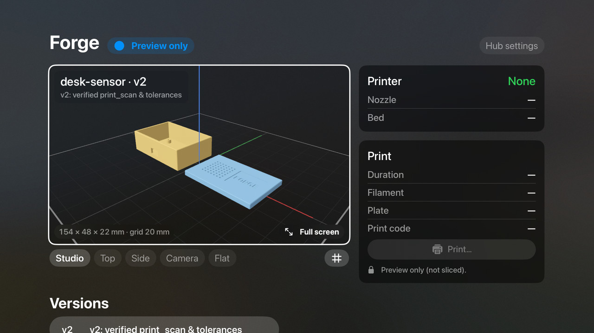

# Forge for Apple TV (tvOS)

Standalone native tvOS client (`Forge`) for inspecting 3D models (`model.usdz`) with the Siri Remote, monitoring multiple printers on your LAN, and starting prints with explicit on-screen confirmation.



---

## Scope & Requirements

**What it does:**
- Lists Forge Hub projects and versions on your local network.
- Renders `model.usdz` natively with RealityKit (Siri Remote pan/orbit/zoom).
- Shows live status for all configured printers and lets you approve/start a print on a selected printer.
- Stores your Hub URL in `UserDefaults` and your Hub bearer token in the Apple TV **Keychain**.

**What it does NOT do:**
- **LAN-only:** connects only to a Forge Hub on your local network (not over the internet / remote gateway).
- **No App Store binary included:** you build and deploy it to your own Apple TV with Xcode using your own Apple Developer account.

**Requirements:**
- macOS with **Xcode 26+** and the **tvOS 26 SDK** *(required for RealityKit on tvOS)*
- Apple Developer account *(free or paid; free accounts re-sign every 7 days)*
- [XcodeGen](https://github.com/yonaskolb/XcodeGen): `brew install xcodegen`
- Forge Hub running on your LAN (`forge serve --lan` or `docker compose -f hub/docker-compose.yml up -d`)
- `usd-core` installed on your workstation (`FORGE_WITH_APPLETV=1 ./install.sh` or `pip install 'forge-cad[appletv]'`) so `forge push` exports `model.usdz` alongside `model.glb`

---

## Build & Run (4 Steps)

```bash
cd clients/appletv
cp Local.xcconfig.example Local.xcconfig
# Edit Local.xcconfig: set DEVELOPMENT_TEAM and PRODUCT_BUNDLE_IDENTIFIER
xcodegen generate
open Forge.xcodeproj
```

Select your Apple TV (or tvOS Simulator) in Xcode and press Run (`Cmd+R`).

## First-Launch Connection
On first launch, enter:
- **Hub URL:** e.g. `http://192.168.1.20:8590` (your Mac's LAN IP if running `forge serve --lan`, or your Raspberry Pi / Docker host IP).
- **Hub Token:** the `appletv` token from `hub/config/tokens` (or the `owner` token printed by `forge serve`).

You can change or clear the saved Hub URL and token anytime from the app's connection settings.
